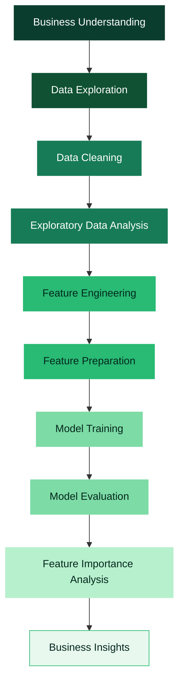

<!-- ═══════════════════════ HEADER ═══════════════════════ -->
<div align="center">


<br/>

<!-- Animated pipeline (file: assets/pipeline-flow.svg) -->


<br/><br/>

<a href="https://www.python.org/"></a>
<a href="https://scikit-learn.org/"></a>
<a href="https://jupyter.org/"></a>

<br/><br/>

<!-- ═══════════════════════ NAVIGATION ═══════════════════════ -->
<a href="#overview"></a>
<a href="#findings"></a>
<a href="#pipeline"></a>
<a href="#model"></a>
<a href="#setup"></a>
<a href="#notebooks"></a>

</div>


<!-- ═══════════════════════ OVERVIEW ═══════════════════════ -->
<a id="overview"></a>

## 📌 Project Overview

This project is completed as part of the **BCG X Data Science Virtual Experience**, focusing on customer churn analysis for **PowerCo**, a major energy utility provider.

PowerCo partnered with BCG X to investigate declining customer retention within its **Small & Medium Enterprise (SME)** customer segment. The initial business hypothesis proposed by PowerCo leadership was that customer churn was primarily driven by **price sensitivity**.

The project applies exploratory data analysis, feature engineering, and predictive modeling to investigate the factors associated with customer churn and develop a machine learning model for identifying customers at higher risk of churn.

### 🎯 Business Objective

The primary objectives of the analysis were to:

- Investigate the factors associated with customer churn.
- Evaluate whether price sensitivity is a major contributor to churn.
- Identify customer characteristics and behavioral patterns associated with churn.
- Engineer meaningful features from customer and pricing data.
- Develop a machine learning model to predict churn risk.
- Translate analytical findings into actionable business insights.


<!-- ═══════════════════════ EXECUTIVE SUMMARY ═══════════════════════ -->
## 💡 Executive Summary

The analysis indicates that **price sensitivity alone does not appear to be the primary driver of customer churn**.

Although pricing-related variables show some relationship with churn, other customer characteristics and historical behavioral variables provide stronger predictive signals.

The analysis highlights the importance of **customer tenure, historical energy consumption, margin-related metrics, and contract-related characteristics** when assessing churn risk.

A **Random Forest Classifier** was developed as the predictive model and achieved approximately **90% overall accuracy** on the test evaluation data.

<div align="center">


</div>

The findings suggest that customer retention strategies should consider a broader range of customer characteristics rather than relying exclusively on price-based interventions.


<!-- ═══════════════════════ KEY FINDINGS ═══════════════════════ -->
<a id="findings"></a>

## 📊 Key Business Findings

<table>
<tr>
<td width="50%" valign="top">

### 1. Price Sensitivity

Price-related variables show some association with customer churn; however, their predictive contribution is relatively limited compared with several customer and consumption-related variables.

The analysis therefore does not support the hypothesis that price sensitivity is the sole or dominant explanation for customer churn.

</td>
<td width="50%" valign="top">

### 2. Customer Tenure

Customer tenure emerged as an important factor in understanding churn behavior. The length of the customer relationship provides useful information when identifying customers who may be at higher risk of leaving.

</td>
</tr>
<tr>
<td width="50%" valign="top">

### 3. Consumption History

Historical energy consumption, particularly information derived from the previous 12 months, provides meaningful predictive information for identifying potential churn.

</td>
<td width="50%" valign="top">

### 4. Margin Metrics

Customer margin-related variables were among the important predictors in the trained model. These metrics can help identify high-value customer accounts where retention efforts may have greater business relevance.

</td>
</tr>
<tr>
<td width="50%" valign="top">

### 5. Contract and Renewal Characteristics

Contract-related information and renewal periods provide additional context for understanding customer churn risk and can support targeted retention activities.

</td>
<td width="50%" valign="top">

### 6. Predictive Model

A **Random Forest Classifier** was trained to predict customer churn.

The model achieved approximately:

**~90% overall test accuracy**

Model evaluation included classification metrics and ROC-based analysis to assess predictive performance.

</td>
</tr>
</table>


<!-- ═══════════════════════ APPROACH ═══════════════════════ -->
## 🔍 Data Analysis Approach

The project follows a structured data science workflow:




<!-- ═══════════════════════ DATASET ═══════════════════════ -->
## 📂 Dataset

The project uses two primary datasets provided as part of the BCG X simulation:

<table>
<tr>
<td width="50%" valign="top">

### Client Data

`client_data.csv`

Contains customer-level information used to understand customer characteristics, consumption behavior, margins, contract information, and churn.

</td>
<td width="50%" valign="top">

### Price Data

`price_data.csv`

Contains historical pricing information used to investigate the relationship between pricing patterns and customer churn.

</td>
</tr>
</table>


<!-- ═══════════════════════ PIPELINE ═══════════════════════ -->
<a id="pipeline"></a>

## 📊 Data Pipeline & Directory Structure

```text
bcg-x-data-science-job-simulation/
│
├── README.md
├── requirements.txt
├── .gitignore
│
├── data/
│   ├── raw/
│   │   ├── client_data.csv
│   │   └── price_data.csv
│   │
│   └── processed/
│       ├── clean_data_after_eda.csv
│       ├── clean_data_engineering.csv
│       └── data_for_prediction.csv
│
├── python_code/
│   ├── 01_exploratory_data_analysis.ipynb
│   ├── 02_feature_engineering.ipynb
│   └── 03_predictive_modeling.ipynb
│
├── reports/
│   ├── Executive_Summary_Slide.pdf
│   
│
└── outputs/
    ├── feature_importances.png
    └── roc_curve.png
```

## 🔄 Data Pipeline

| Stage                  | Dataset                             | Description                                                                                                                                   |
| ---------------------- | ----------------------------------- | --------------------------------------------------------------------------------------------------------------------------------------------- |
| **Raw Input**          | `client_data.csv`, `price_data.csv` | Original customer and historical pricing records provided by PowerCo.                                                                         |
| **Cleaned**            | `clean_data_after_eda.csv`          | Dataset prepared after exploratory analysis, including data cleaning, duplicate handling, missing-value treatment, and data-type corrections. |
| **Feature Engineered** | `clean_data_engineering.csv`        | Dataset enriched with pricing variation metrics, peak/off-peak price differences, tenure-related features, and other derived variables.       |
| **Model Ready**        | `data_for_prediction.csv`           | Transformed dataset prepared for machine learning model training and prediction.                                                              |


<!-- ═══════════════════════ PREPARATION & FEATURES ═══════════════════════ -->
## 🧹 Data Preparation

The data preparation process included:

- Inspecting dataset structure and data types.
- Identifying missing values.
- Checking for duplicate records.
- Handling data-quality issues.
- Converting variables into appropriate data types.
- Investigating distributions and relationships between variables.
- Preparing datasets for feature engineering and predictive modeling.

## ⚙️ Feature Engineering

Feature engineering was performed to transform the available customer and pricing information into variables that could provide stronger predictive signals.

The engineered features included information related to:

- Customer tenure.
- Historical energy consumption.
- Pricing variation.
- Peak and off-peak price differences.
- Customer margin.
- Contract-related characteristics.
- Other relevant customer and pricing attributes.

These engineered variables were subsequently prepared for use in the predictive modeling workflow.


<!-- ═══════════════════════ MODEL ═══════════════════════ -->
<a id="model"></a>

## 🤖 Machine Learning Model

### Random Forest Classifier

A **Random Forest Classifier** was used for customer churn prediction.

Random Forest was selected because it can:

- Handle multiple numerical and categorical features.
- Capture non-linear relationships.
- Model interactions between variables.
- Provide feature importance information.
- Work effectively as a baseline classification approach for structured tabular data.

### Model Evaluation

The trained model was evaluated using test data.

Evaluation included:

- Accuracy
- Classification performance metrics
- ROC curve analysis
- Feature importance analysis

The model achieved approximately **90% overall accuracy** on the test evaluation data.

## 📈 Model Interpretability

Feature importance analysis was used to understand which variables contributed most to the model's churn predictions.

The analysis highlighted variables related to:

- Total net margin.
- Customer tenure.
- Historical consumption.
- Contract and renewal characteristics.
- Pricing-related behavior.

The feature importance results helped connect the machine learning output with the underlying business problem.

## 📉 Model Outputs

The project generates visual outputs to support model interpretation and evaluation.

<table>
<tr>
<td width="50%" valign="top">

### Feature Importance

`outputs/feature_importances.png`

Visualizes the relative importance of features used by the Random Forest model.

</td>
<td width="50%" valign="top">

### ROC Curve

`outputs/roc_curve.png`

Provides a visual evaluation of the model's classification performance across different decision thresholds.

</td>
</tr>
</table>


<!-- ═══════════════════════ RECOMMENDATIONS & DELIVERABLES ═══════════════════════ -->
## 💼 Business Recommendations

Based on the analysis, customer retention strategies can consider:

- Monitoring customers approaching contract renewal periods.
- Identifying high-value accounts using margin-related metrics.
- Considering historical consumption behavior when assessing churn risk.
- Using customer tenure as an additional risk indicator.
- Combining pricing information with broader customer characteristics rather than relying exclusively on price sensitivity.
- Using predictive modeling to support targeted retention initiatives.

These recommendations are based on the analytical findings from the simulation dataset and should be considered within the broader business context.

## 📋 Project Deliverables

The completed project includes:

- [x] Exploratory Data Analysis notebook.
- [x] Feature Engineering notebook.
- [x] Predictive Modeling notebook.
- [x] Processed datasets.
- [x] Feature importance visualization.
- [x] ROC curve visualization.
- [x] Executive summary presentation.
- [x] HTML version of the executive report.


<!-- ═══════════════════════ TECH STACK ═══════════════════════ -->
## 🛠️ Technology Stack

<div align="center">

<table align="center"><tr>
<td align="center" width="95"><br/><sub><b>Python</b></sub></td>
<td align="center" width="95"><picture><source media="(prefers-color-scheme: dark)" srcset="https://cdn.simpleicons.org/pandas/ffffff"></picture><br/><sub><b>Pandas</b></sub></td>
<td align="center" width="95"><br/><sub><b>NumPy</b></sub></td>
<td align="center" width="95"><br/><sub><b>Matplotlib</b></sub></td>
<td align="center" width="95"><br/><sub><b>Seaborn</b></sub></td>
<td align="center" width="95"><br/><sub><b>Scikit-Learn</b></sub></td>
<td align="center" width="95"><br/><sub><b>Jupyter</b></sub></td>
<td align="center" width="95"><br/><sub><b>HTML5</b></sub></td>
<td align="center" width="95"><br/><sub><b>CSS3</b></sub></td>
<td align="center" width="95"><picture><source media="(prefers-color-scheme: dark)" srcset="https://cdn.simpleicons.org/github/ffffff"></picture><br/><sub><b>Git / GitHub</b></sub></td>
</tr></table>

</div>

| Category                    | Technologies             |
| --------------------------- | ------------------------ |
| **Programming Language**    | Python 3.9+              |
| **Data Manipulation**       | Pandas, NumPy            |
| **Data Visualization**      | Matplotlib, Seaborn      |
| **Machine Learning**        | Scikit-Learn             |
| **Model**                   | Random Forest Classifier |
| **Development Environment** | Jupyter Notebook         |
| **Reporting**               | HTML5, CSS3, ReportLab   |
| **Version Control**         | Git / GitHub             |

## 📦 Python Libraries

The primary libraries used in the project include:

```text
pandas
numpy
matplotlib
seaborn
scikit-learn
jupyter
```


<!-- ═══════════════════════ SETUP ═══════════════════════ -->
<a id="setup"></a>

## 🚀 Setup & Execution

### 1. Clone the Repository

```bash
git clone https://github.com/paraskosambe-web/bcg-x-data-science-job-simulation.git
cd bcg-x-data-science-job-simulation
```

### 2. Create a Virtual Environment

<table>
<tr>
<td width="50%" valign="top">

#### Windows

```bash
python -m venv venv
venv\Scripts\activate
```

</td>
<td width="50%" valign="top">

#### macOS / Linux

```bash
python3 -m venv venv
source venv/bin/activate
```

</td>
</tr>
</table>

### 3. Install Dependencies

```bash
pip install -r requirements.txt
```

### 4. Launch Jupyter Notebook

```bash
jupyter notebook
```

Open the notebooks from the `notebooks/` directory and execute them in sequence.


<!-- ═══════════════════════ NOTEBOOKS ═══════════════════════ -->
<a id="notebooks"></a>

## 📓 Notebook Structure

<details open>
<summary><b><code>01_exploratory_data_analysis.ipynb</code></b></summary>
<br/>

Covers:

- Dataset inspection.
- Data quality checks.
- Missing-value analysis.
- Duplicate detection.
- Exploratory data analysis.
- Customer churn patterns.
- Pricing and consumption analysis.

</details>

<details open>
<summary><b><code>02_feature_engineering.ipynb</code></b></summary>
<br/>

Covers:

- Creation of derived features.
- Pricing variation metrics.
- Peak/off-peak pricing differences.
- Tenure-related features.
- Preparation of variables for machine learning.

</details>

<details open>
<summary><b><code>03_predictive_modeling.ipynb</code></b></summary>
<br/>

Covers:

- Data preparation.
- Train-test split.
- Random Forest model development.
- Model evaluation.
- Feature importance analysis.
- ROC curve analysis.

</details>


<!-- ═══════════════════════ OUTCOME ═══════════════════════ -->
## 📊 Project Outcome

The project demonstrates an end-to-end data science workflow, from **business problem understanding and data exploration to feature engineering, machine learning, model evaluation, and business interpretation**.

The analysis provides evidence that churn risk should be examined using a combination of customer, consumption, margin, contract, and pricing characteristics rather than focusing exclusively on price sensitivity.

## 🎓 Virtual Experience

This project is completed as part of the:

**BCG X Data Science Virtual Experience Program**

The simulation provides practical exposure to applying data science techniques to a business problem involving customer churn, feature engineering, predictive modeling, and communicating analytical findings to stakeholders.

## 👨‍💻 Author

**Paras**

B.Sc. Computer Science Student | Aspiring Data Scientist

Areas of interest:

- Data Science
- Artificial Intelligence & Machine Learning
- Python
- SQL
- Data Analysis
- Predictive Modeling

## 📄 Disclaimer

This repository is created for educational and portfolio purposes based on the BCG X Data Science Virtual Experience. The analysis and conclusions presented are based on the datasets and business context provided within the simulation.


